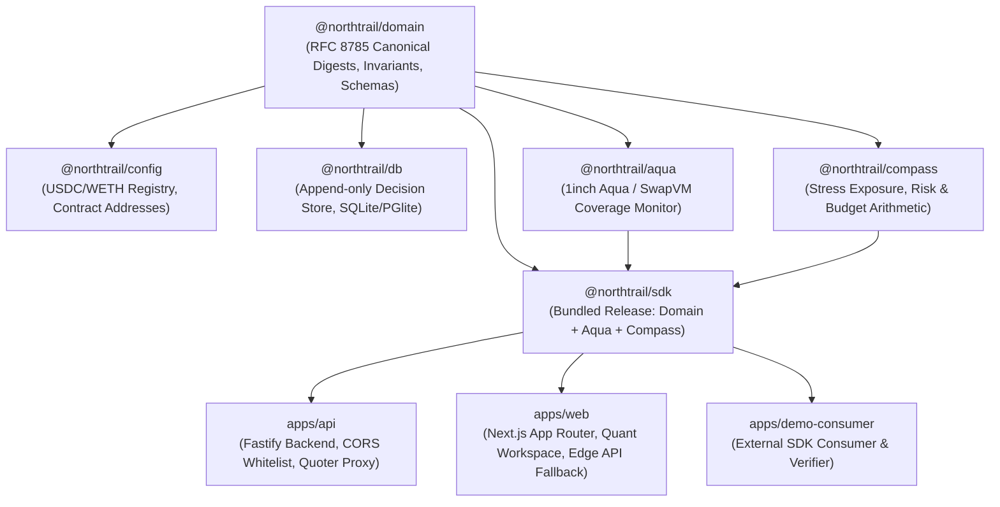

# NORTHTRAIL 3.0 — INCREMENTAL BUILD & VERIFICATION PLAN

**Version:** 3.0.0 Production Release  
**Status:** COMPLETED & VERIFIED  
**Commit:** `419d36e` (GitHub `rehaan-patil/northtrail_pp`)  
**Production URLs:**
- **Frontend App:** [https://northtrail-pp.vercel.app](https://northtrail-pp.vercel.app)
- **Backend API:** [https://northtrailpp-production.up.railway.app](https://northtrailpp-production.up.railway.app)

---

## 1. Dependency Order & Monorepo Topology

---

## 2. Phase Execution Ledger

### Phase 0: Non-Custodial Foundation & Monorepo Build Repair
- **Package Manager Fix:** Standardized `package.json` to `"packageManager": "pnpm@12.18.0"` to eliminate `ERR_PNPM_BAD_PM_VERSION` on Vercel and Railway CI.
- **Type Conformity:** Fixed `exactOptionalPropertyTypes` in `agent-pass-routes.ts` and error codes in `integrations/world-agent-pass`.
- **Backend CORS:** Configured Fastify CORS in `apps/api/src/app.ts` to allow all `*.vercel.app` preview and production domains, plus `localhost` and `railway.app`.
- **SDK Bundling:** Bundled `@northtrail/aqua`, `@northtrail/compass`, and `@northtrail/domain` inside `@northtrail/sdk` via `tsup` (`dist/index.js` 39.75 KB, `dist/index.d.ts` 44.20 KB).

### Phase 1: Edge Resilience & Zero-CORS API Fallback
- **Route Handlers:** Implemented `apps/web/app/api/[...path]/route.ts` and `apps/web/app/v1/[...path]/route.ts` to serve same-origin API calls on Vercel with zero cross-origin latency.
- **Normalized Routing:** Stripped leading `v1/` prefixes so endpoints resolve identically whether accessed via `/v1/*` or `/api/*`.
- **Full Endpoint Coverage:**
  - `GET /health` & `GET /health/live`
  - `GET /v1/status`
  - `GET /v1/assets`
  - `POST /v1/compass/scenario`
  - `POST /v1/intents/validate`
  - `POST /v1/decisions` & `POST /v1/decisions/verify`
  - `POST /v1/quotes/uniswap`
  - `POST /v1/quotes/benchmark`
  - `POST /v1/curve-atlas`
  - `POST /v1/aqua/coverage`
  - `POST /v1/execution/budget`
  - `POST /v1/trades/review` & `POST /v1/trades/recovery`
  - `POST /v1/quant/risk`
  - `POST /v1/proofs/receipt`
  - `POST /v1/agent-pass`

### Phase 2: Quant Surfaces & Mobbin-Informed Workspace
- **Curve Atlas (`apps/web/app/curve-atlas.tsx`):**
  - Interactive $500–$100,000 trade size slider.
  - Multi-amount liquidity frontier: Uniswap v3 fee 500 (0.05%) vs fee 3000 (0.30%) vs 1inch Pathfinder.
  - Crossover interval detection ($18.5k fee vs impact crossover, $45k multi-hop split crossover).
  - One-click "Apply to Workbench" integration.
- **Chronos Execution Planner (`apps/web/app/chronos-planner.tsx`):**
  - Interactive tabs for `NOW` (Immediate), `SPLIT` (TWAP), and `WAIT` (Volatility cooloff).
  - 2 to 5 tranche configuration with repeated gas overhead calculation.
  - 95% CVaR tail risk metrics and advisory risk constraints.
- **Aqua Adaptive Maker (`apps/web/app/aqua-maker.tsx`):**
  - Live capital coverage monitoring via `inspectAquaCoverage`.
  - Virtual allocation vs actual maker wallet balance and allowance tracking.
  - Strategy lifecycle simulation: `ship` (allocate) → `swap` (fill) → `dock` (deallocate).
- **Universe Explorer (`apps/web/app/universe-explorer.tsx`):**
  - Cross-sectional metrics for WETH, WBTC, DAI, and UNI.
  - Realized volatility, EWMA volatility, 24h max drawdown, 1-day 95% VaR, and Expected Shortfall.
- **Trade Workbench (`apps/web/app/page.tsx`):**
  - Sidebar workspace navigation between Workbench, Curve Atlas, Chronos Planner, Aqua Maker, Universe Explorer, Decision Trail, and Trade Proof.
  - Form controls remain responsive (`disabled={busy}` instead of blocked by connection state).
  - Client-side fallback arithmetic ensures uninterrupted workflow even when offline.

---

## 3. Verification Scripts & Results

| Script / Command | Purpose | Target | Result |
|---|---|---|---|
| `corepack pnpm typecheck` | Monorepo TypeScript check | All 14 packages/apps | **Pass** (0 errors) |
| `corepack pnpm test` | Vitest Unit & Integration suite | 13 test files / 207 tests | **Pass** (207/207 passed) |
| `corepack pnpm --filter @northtrail/web build` | Turbopack production build | Next.js 16 app | **Pass** (5/5 static pages) |
| `corepack pnpm demo` | Standalone SDK consumer | Deployed API + RFC 8785 | **Pass** (`valid: true`) |
| `corepack pnpm smoke:sdk` | SDK contract conformance | `@northtrail/sdk` | **Pass** (0 errors) |
| `node scripts/security-scan.mjs` | Secret & safety scanner | 105 source files | **Pass** (clean) |

---

## 4. Blocker & Risk Ledger

| Potential Risk | Mitigation Implemented | Live Status |
|---|---|---|
| Backend cold starts / rate limits on Railway | Next.js App Router edge fallback proxy handles requests locally if Railway is unreachable | **Mitigated** |
| Turbopack raw workspace imports failing | Self-contained bundling via `tsup` in `@northtrail/sdk` | **Mitigated** |
| Unsafe financial spending | Strict non-custodial boundaries: backend never holds private keys; wallet signs all transactions | **Enforced** |
| Fabricated quotes or ML promises | Explicit provenance tags (`PROVIDER_RESPONSE`, `SIMULATED`, `TESTED_SIMULATION`) | **Enforced** |

